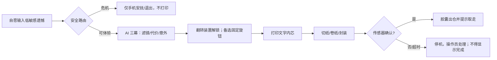

# 《没走的路》胶囊版 PRD v0.2（评审草案）

> 2026-10-12；承接 [原 PRD v0.1](PRD.md)。它不是原小票功能的已完成声明。软硬件差异、评审阻断项见 [PRODUCT_REVIEW.md](PRODUCT_REVIEW.md)。

## 一、为什么做

**一句话**：你写下一条没走的路，AI 为它拆滤镜、承认得失；装置先打印一段虚构人生，再将纸带卷入一颗**不可吞食的展示胶囊**交给你。

**目标用户**：展览现场、愿意提供低敏感反事实选择并理解幽默边界的成年人。**排除**严重心理危机、刚遭遇重大创伤、未成年人无人监护等场景；不诊断、不承诺缓解心理问题。选择不公开分享、随时退出不受惩罚。

**用户结果**：体验者说出“我想象的那条路也有代价”，同时没有感到被羞辱/被判定命运。物理产物是记忆载体，不是疗效证据。

**角色**：体验者（输入、选择是否继续、取走道具）；现场工作人员（补纸、装胶囊、急停/排障）；系统（内容安全、生成、状态机、打印）；设备（传感器、切纸、卷纸、封壳、出仓）。

**非目标**：真实药品、医疗/心理治疗、准确预测另一种人生、根据隐私画像断言第三方行为、实时三格 AI 出图、无人监管的公网运营。

## 二、MVP 主链路和切片

**当前 vertical slice**：手机输入、StepFun 文本生成、翻转、58mm 文字内芯、WebSocket capsule 协议、模拟设备完成。无真机时屏幕展示**模拟**打印和封装，不声称交付实物。旧设备只回小票，不伪装支持胶囊。

**互动趣味（按证据逐步加入）**：
1. Now：翻转解锁“滤镜→代价→意外”，灯光/声音在纸带进入卷轴时变为琥珀色；**不是边翻边打印**。
2. Next：固定旋钮从“如果”转到“其实”，用户可以在手机上挑一句愿意带走的当下注脚；是否加入小票先测，再处理隐私。
3. Later：胶囊外贴编号/扫码由用户选择是否公开分享。声音、振动与墨水屏仅在不增加等待或卡纸时再做。

## 三、可执行需求

| ID | 优先级 | 用户故事 / 规则 | 验收（软件 / 硬件） |
| --- | --- | --- | --- |
| C-01 | P0 | 作为体验者，我可输入 10–100 字并明确知道是虚构故事 | 普通输入不足 10 字/超过 100 字不生成；短危机输入优先进入安抚；危机内容只在手机展示安抚，不发送 task，不打印或出胶囊 |
| C-02 | P0 | AI 生成三幕，承认吸引力→具体日常代价→克制荒诞落点 | 结构化校验；不含死亡/重病/贫困作笑点；错误/断网显式标演示案例；人工内容评估未完成不得宣称安全 |
| C-03 | P0 | 作为体验者，我先完成动作再允许打印 | 收到完整动作进度才授权打印；未授权 `print_started` 不进入下一步；重复/越权消息不改变完成状态 |
| C-04 | P0 | 作为设备，我只装入文字内芯 | 胶囊能力握手决定 `delivery=capsule`，不打印图与二维码；旧设备 `delivery=receipt`；内芯印“虚构·非预测/展示道具·不可吞食”和编号 |
| C-05 | P0 | 作为体验者，我仅在胶囊真的出仓后看到“完成” | `print_done`→`encapsulating`，设备确认 `paperCaptured`、`capsuleClosed`、`outletClear` 全为 true 才 `done`；超时/断线/缺纸/卡纸/空壳/盖开/出仓堵塞进 error |
| C-06 | P0 | 作为操作员，任何运动故障可停机 | 独立物理急停和盖板互锁；通信断开与超时硬件侧也必须断电；按钮重试不可自动重印或重复出仓，人工检查后重新建任务 |
| C-07 | P0 | 作为用户，我不需要公开我的遗憾 | 分享默认关闭/另行同意；服务端不向公开结果返回原始输入；24h TTL 只清内存，需核查日志和模型供应商数据策略 |
| C-08 | P1 | 作为操作员，我能判断失败在哪一段 | 设备状态和错误码区分打印、卷纸、合壳、出仓；匿名统计分段耗时与故障，绝不上传原文作为埋点 |

### 字段/契约重点

`Session.state`: `created | generating | await_demo | await_action | printing | encapsulating | done | error`。`delivery`: `demo | receipt | capsule`。`hello.capabilities.capsule` 只声明**协议模拟能力**，不是机械安全认证。设备上报 `capsule_dispensed` 必须同时包含三项传感器结果；服务端只把消息作为状态证据，无法验证传感器是否真实。任何单项 false、错 session、错设备、未授权消息都不许完成。

**纸带**：58mm 热敏打印机，文字版三幕；不裁成 58mm 以下的小口服胶囊。展示胶囊轴向长度按 ≥65mm *提案*打样，不可标为药品或食品。切刀应与打印机实际型号匹配；纸长、卷径、热敏面朝向与 QR（当前胶囊无 QR）均需实测。若需要普通小胶囊，必须另选窄幅打印方案并重做纸路。

**AI 必要性与边界**：AI 只负责对用户输入生成个性化、结构化“另一条路”叙事；相同规则的非 AI 静态案例是断网降级，不应在现场伪称个性化。模型可以给出不同的具体生活成本，不可以宣称这些必然发生；AI 图片与亲历者心理建议均非 MVP 必需。

### 异常与退路

| 场景 | 用户看到 | 操作员动作 |
| --- | --- | --- |
| 危机输入 | 安抚文案，可退出，不会出胶囊 | 不围观/不读出输入；必要时按当地正式求助指引处理 |
| 模型不可用 | 明确“演示案例”，用户可放弃 | 检查网络与 Key，不伪装实时生成 |
| 设备未接入 | “模拟体验，不会拿到实物” | 启动 mock 只作联调；真实出仓不能靠定时器 |
| 打印完但封装失败 | “未完成，请工作人员处理” | 急停、断电、取出损坏纸带；不得自动重试造成双份 |
| 用户中途取消/设备断线 | 当前任务中止，不能靠旧 ack 复活 | 检查装置内部残留纸带后手动清空 |

## 四、非功能/上线门槛

- 时间目标为**假设**：从提交到可取胶囊 P50 ≤120s、P95 ≤180s；记录生成/打印/封装三个分段，不把“模型生成 30s”当作完整交付。若不达标，减少文字或预生成示例，不牺牲互锁。
- 展台要有操作员、急停、透明防夹手罩、不可吞服标识、备用纸/空壳、回收盒；用户只接触成品。真机 20 次连续成功 + 故障注入通过前，不做无人值守。
- 公网/多人使用前必须做设备鉴权、API 访问限制、会话绑定、输入同意/分享选择、敏感内容审核和适用地区隐私评估。现有本地 server **不满足**这些条件。
- 匿名事件建议：`session_generate_start/complete/fail`, `action_complete`, `print_complete`, `capsule_complete/fail`, `session_cancel`；仅记录随机 session、模式、分段毫秒、错误码，不存原文。**尚未实现**。
- 内容可用性与安全评价：在样本中分别报告核心信息复述率、“被冒犯”反馈率；不以领走/扫码作为心理改善代理指标。

## 五、版本与待确认

**Now（内部 demo）**：本轮软件协议/模拟 + 人工审核示例 + 最小台架。**Next（受控展台）**：物理闭环、硬件安全、隐私同意、可观察性。**Later**：旋钮/选择当下注脚、AI 图像/外壳升级。

必须由团队确认：①展示胶囊允许 ≥65mm 长吗？②最终体验是“翻转整个机器”还是“固定机器+旋钮”？③能否接受危机输入不打印和分享默认关闭？④是否有机械/电气负责人签署安全验收？若答案改变，本 PRD 的纸路与交互要重评。
